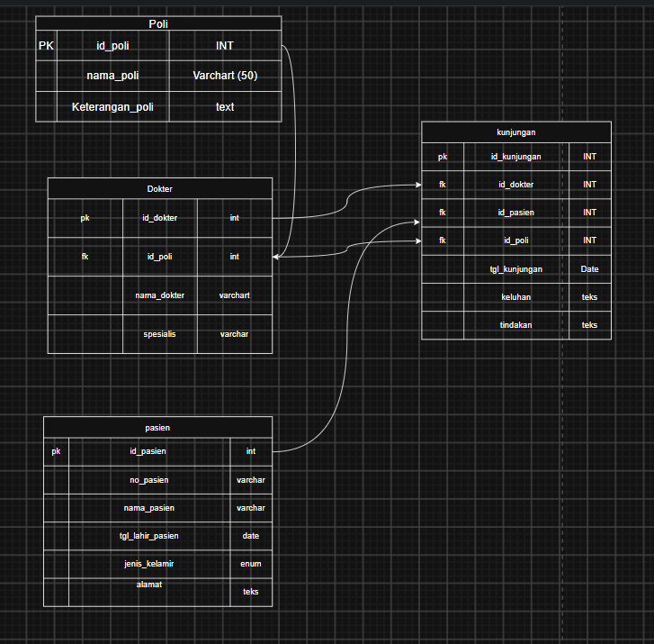

# Laporan Praktikum Basis Data - Pertemuan Sistem Klinik
<div align="center">

# LAPORAN PRAKTIKUM
## BASIS DATA
### SISTEM KLINIK

<br>

|

*Dosen Pengampu : Dedi Irawan, S.Kom., M.T.I.*  
*Mata Kuliah : Basis Data*

<br>


<br>

**Disusun oleh:**

**Dea Novita (25430104)**  
**Wanda Talia (25430109)**  
**Sherly Adi Ramadani (25430100)**  

<br>
<br>

### PROGRAM STUDI ILMU KOMPUTER
### FAKULTAS ILMU KOMPUTER
### UNIVERSITAS MUHAMMADIYAH METRO
### 2026

</div>
---

### 1. Tujuan Praktikum
* Memahami perancangan basis data relational untuk sistem informasi klinik menggunakan phpMyAdmin dan MySQL.
* Mampu mendefinisikan struktur tabel, menentukan tipe data yang tepat (seperti `INT`, `VARCHAR`, `DATE`, `ENUM`, `TEXT`), serta mengonfigurasi *Primary Key* dan *Foreign Key* (relasi antar tabel).
* Mampu mengimplementasikan aturan integritas referensial dengan klausa `ON DELETE CASCADE` dan `ON UPDATE CASCADE`.
* Mampu menggunakan fitur *Designer* pada phpMyAdmin untuk memvisualisasikan relasi tabel dalam basis data `sistem_klinik`.

### 2. Ringkasan Dasar Teori
Dalam sistem manajemen basis data relasional (RDBMS), perancangan tabel yang baik memerlukan pemahaman mengenai normalisasi dan relasi antar entitas. Relasi antar tabel dihubungkan melalui *Primary Key* dari suatu tabel utama yang direferensikan sebagai *Foreign Key* pada tabel anak (*dependent table*). 
* **One-to-Many Relational Concept:** Sebagai contoh dalam klinik, satu poli dapat memiliki banyak dokter, dan satu dokter dapat melayani banyak kunjungan. Begitu pula dengan data pasien terhadap kunjungan.
* **Integritas Referensial (`ON DELETE CASCADE` & `ON UPDATE CASCADE`):** Digunakan untuk memastikan konsistensi data. Jika data induk (*parent*) dihapus atau diperbarui, maka data terkait pada tabel anak (*child*) akan ikut terhapus atau diperbarui secara otomatis.
* **Desainer phpMyAdmin:** Fitur visual untuk memetakan hubungan ketergantungan antar entitas secara grafis agar struktur skema basis data mudah dipahami.

### 3. Hasil Langkah Percobaan
* **Tangkapan Layar:**  
  *(Contoh penyisipan gambar tangkapan layar phpMyAdmin Designer di VS Code)*  
  

  **Tangkapan Layar:** *
  *(Contoh hasil perancangan ERD sistem klinik menggunakan draw.io)*
  

* **Keterangan:**  
  Gambar di atas menampilkan hasil perancangan skema relasional basis data `sistem_klinik` melalui fitur *Designer* phpMyAdmin. Terlihat jelas relasi garis penghubung antar tabel:
  1. Tabel `poli` berelasi dengan tabel `dokter` melalui `id_poli`.
  2. Tabel `poli` berelasi dengan tabel `kunjungan` melalui `id_poli`.
  3. Tabel `dokter` berelasi dengan tabel `kunjungan` melalui `id_dokter`.
  4. Tabel `pasien` berelasi dengan tabel `kunjungan` melalui `id_pasien`.

### 4. Jawaban Titik Analisis
* **Mengapa penggunaan Foreign Key penting dalam sistem klinik?**  
  *Foreign Key* memastikan integritas data antar tabel tetap terjaga, mencegah adanya data yatim (*orphan data*), misalnya data kunjungan yang merujuk pada ID pasien atau dokter yang tidak terdaftar di dalam sistem.
* **Apa fungsi dari klausa `ON DELETE CASCADE` dan `ON UPDATE CASCADE`?**  
  Klausa ini mengotomatiskan pemeliharaan konsistensi data. Apabila sebuah data master (seperti data poli atau pasien) diubah atau dihapus, baris data terkait di tabel transaksional (`kunjungan` atau `dokter`) akan menyesuaikan secara otomatis tanpa melanggar batasan kunci asing.

### 5. Hasil Latihan dan Modifikasi
Skrip SQL implementasi pembuatan database `sistem_klinik` beserta relasinya dengan tipe data standar modern:

```sql
-- Buat database baru
CREATE DATABASE IF NOT EXISTS sistem_klinik;
USE sistem_klinik;

-- 1. Tabel Poli
CREATE TABLE poli (
    id_poli INT AUTO_INCREMENT PRIMARY KEY,
    nama_poli VARCHAR(50),
    keterangan_poli TEXT
);

-- 2. Tabel Dokter (Berelasi dengan tabel Poli)
CREATE TABLE dokter (
    id_dokter INT AUTO_INCREMENT PRIMARY KEY,
    id_poli INT,
    nama_dokter VARCHAR(100),
    spesialis VARCHAR(100),
    FOREIGN KEY (id_poli) REFERENCES poli(id_poli) ON DELETE CASCADE ON UPDATE CASCADE
);

-- 3. Tabel Pasien
CREATE TABLE pasien (
    id_pasien INT AUTO_INCREMENT PRIMARY KEY,
    no_pasien VARCHAR(50),
    nama_pasien VARCHAR(100),
    tgl_lahir_pasien DATE,
    jenis_kelamin ENUM('Laki-laki', 'Perempuan'),
    alamat TEXT
);

-- 4. Tabel Kunjungan (Berelasi dengan Dokter, Pasien, dan Poli)
CREATE TABLE kunjungan (
    id_kunjungan INT AUTO_INCREMENT PRIMARY KEY,
    id_dokter INT,
    id_pasien INT,
    id_poli INT,
    tgl_kunjungan DATE,
    keluhan TEXT,
    tindakan TEXT,
    FOREIGN KEY (id_dokter) REFERENCES dokter(id_dokter) ON DELETE CASCADE ON UPDATE CASCADE,
    FOREIGN KEY (id_pasien) REFERENCES pasien(id_pasien) ON DELETE CASCADE ON UPDATE CASCADE,
    FOREIGN KEY (id_poli) REFERENCES poli(id_poli) ON DELETE CASCADE ON UPDATE CASCADE
);
```

### 6. Tugas Mandiri: Milestone Proyek
* **Deskripsi Milestone:** Menyusun rancangan basis data sistem informasi klinik terpadu yang mencakup pengelolaan rekam medis pasien, penjadwalan poli dan dokter, serta pencatatan transaksi kunjungan berobat harian.
* **Penerapan pada Proyek:** Skema database `sistem_klinik` ini akan menjadi fondasi *back-end* bagi pengembangan aplikasi manajemen klinik berbasis web yang mendukung fasa CRUD secara menyeluruh pada modul administrasi pasien dan dokter.

### 7. Pembahasan dan Kendala
* **Pembahasan:** Praktikum berjalan lancar mulai dari pembuatan database, pendefinisian tabel dengan tipe data yang bersih dari panjang digit eksplisit yang usang (seperti `INT`), hingga pengujian relasi foreign key pada phpMyAdmin.
* **Kendala:** Sempat terjadi penyesuaian pada penamaan indeks atau tipe data default di phpMyAdmin, namun berhasil diselesaikan dengan merestrukturisasi query SQL agar kompatibel secara penuh dengan standar versi MySQL terbaru.

### 8. Kesimpulan
Perancangan basis data `sistem_klinik` berhasil diselesaikan dengan menerapkan prinsip normalisasi dasar dan integritas relasional antar entitas (`poli`, `dokter`, `pasien`, dan `kunjungan`). Fitur *Designer* di phpMyAdmin sangat membantu dalam memvalidasi kebenaran skema relasi secara visual.

### 9. Pernyataan Penggunaan AI
*Saya menyatakan bahwa dalam penyusunan laporan praktikum ini, saya menggunakan bantuan kecerdasan buatan (AI) untuk membantu merapikan sintaks SQL, menyusun struktur dokumentasi laporan, serta mengonfirmasi kesesuaian format praktikum.*

### 10. Bukti Git
* **Tautan Repositori:** [GitHub - basisdata_25430104](https://github.com/yaya-dotcom0212/basisdata_25430104)

