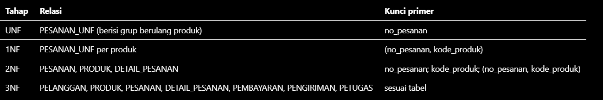
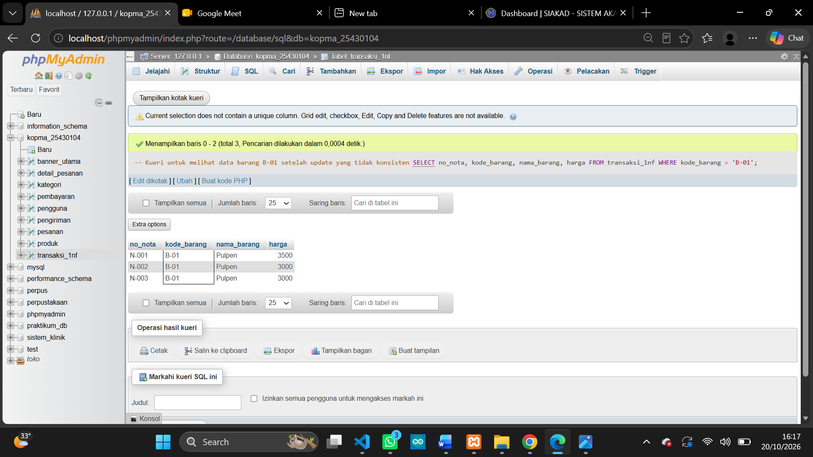

# Laporan Praktikum Basis Data - Pertemuan 04

**Nama:** Dea Novita  **NIM:** 25430104  **Kelas:** D **Tanggal:** 17 Oktober 2026 


## 1. Tujuan Praktikum

Pada pertemuan ini saya belajar menemukan anomali pada data yang belum dinormalisasi, menuliskan dependensi fungsional dari aturan bisnis, memecah tabel sampai bentuk normal ketiga (3NF), dan memeriksa BCNF. Saya juga belajar memutuskan nilai turunan mana yang disimpan dan mana yang dihitung ulang.


## 2. Ringkasan Dasar Teori

Data yang disimpan berulang dalam satu tabel besar menimbulkan tiga anomali: anomali ubah (satu fakta ditulis di banyak baris dan bisa tidak konsisten), anomali sisip (fakta tidak bisa dicatat sebelum fakta lain ada), dan anomali hapus (menghapus satu fakta ikut menghapus fakta lain).

Dependensi fungsional ditulis A → B jika setiap nilai A menentukan tepat satu nilai B. Dependensi ini diturunkan dari aturan bisnis, bukan ditebak dari contoh data.

Normalisasi dilakukan bertahap. 1NF menuntut nilai atomik tanpa grup berulang. 2NF menuntut tidak ada atribut bukan kunci yang bergantung pada sebagian kunci komposit. 3NF menuntut tidak ada atribut bukan kunci yang bergantung pada atribut bukan kunci lain. BCNF menuntut setiap penentu adalah kunci kandidat.


## 3. Hasil Langkah Percobaan

Saya mengerjakan normalisasi untuk dua proyek P2 saya. Hasil lengkapnya ada di dua berkas berikut:

- `p04_normalisasi_25430104.md`: proyek **Toko Daring Lampung**
- `p04_normalisasi_kopma_25430104.md`: proyek **Kopma**

### 3.1 Tahapan UNF sampai 3NF (proyek Toko Daring Lampung)

| Tahap | Relasi | Kunci primer |
|---|---|---|
| UNF | PESANAN_UNF (berisi grup berulang produk) | no_pesanan |
| 1NF | PESANAN_UNF per produk | (no_pesanan, kode_produk) |
| 2NF | PESANAN, PRODUK, DETAIL_PESANAN | no_pesanan; kode_produk; (no_pesanan, kode_produk) |
| 3NF | PELANGGAN, PRODUK, PESANAN, DETAIL_PESANAN, PEMBAYARAN, PENGIRIMAN, PETUGAS | sesuai tabel |


### 3.2 Dependensi fungsional (Toko Daring Lampung)

| Kode | Dependensi | Dasar (AB) |
|---|---|---|
| FD1 | no_pesanan → tgl_pesanan, id_pelanggan, diskon_member, ongkos_kirim, status_pesanan | Invoice |
| FD2 | id_pelanggan → nama, email, no_hp, alamat_lampung, status_member, poin_loyalitas | Formulir profil |
| FD3 | email_pelanggan → id_pelanggan; no_hp_pelanggan → id_pelanggan | AB-06 |
| FD4 | kode_produk → nama_produk, kategori_khas, harga_jual, stok_produk, min_stok | Katalog |
| FD5 | (no_pesanan, kode_produk) → qty_pesanan, harga_satuan_pesanan | AB-04 |
| FD6 | (qty_pesanan, harga_satuan_pesanan) → subtotal | Nilai turunan |
| FD7 | no_pesanan → kode_pembayaran, metode_bayar, tgl_bayar, jumlah_bayar, status_pembayaran | Asumsi A1 |
| FD8 | no_pesanan → no_resi, nama_ekspedisi, berat_paket, tgl_kirim, tgl_diterima, status_pengiriman | Asumsi A2 |
| FD9 | no_resi → no_pesanan | AB-06 |

### 3.3 Skema 3NF proyek Toko Daring Lampung

```
PELANGGAN      (id_pelanggan, nama_pelanggan, email_pelanggan UNIQUE, no_hp_pelanggan UNIQUE, alamat_lampung, status_member, poin_loyalitas)
PRODUK         (kode_produk, nama_produk, kategori_khas, harga_jual, stok_produk, min_stok)
PESANAN        (no_pesanan, tgl_pesanan, id_pelanggan*, diskon_member, ongkos_kirim, status_pesanan)
DETAIL_PESANAN (no_pesanan*, kode_produk*, qty_pesanan, harga_satuan_pesanan)
PEMBAYARAN     (kode_pembayaran, no_pesanan* UNIQUE, tgl_bayar, metode_bayar, jumlah_bayar, status_pembayaran)
PENGIRIMAN     (no_resi, no_pesanan* UNIQUE, nama_ekspedisi, berat_paket, tgl_kirim, tgl_diterima, status_pengiriman)
PETUGAS        (kode_petugas, nama_petugas, peran_petugas)
```

### 3.4 Keputusan nilai turunan (Toko Daring Lampung)

| Nilai | Disimpan / dihitung | Alasan |
|---|---|---|
| subtotal | Dihitung | qty × harga satuan; harga dikunci oleh AB-04 |
| total_harga | Dihitung | SUM(subtotal) − diskon_member + ongkos_kirim |
| diskon_member | Disimpan | Bergantung pada status member saat transaksi (AB-02), yang bisa berubah |
| jumlah_bayar | Disimpan | Uang yang benar-benar dibayarkan |
| poin_loyalitas | Disimpan | Saldo berjalan; tidak bisa dihitung dari satu pesanan |

### 3.5 Pemeriksaan BCNF

Semua tabel memenuhi BCNF. Pada PEMBAYARAN dan PENGIRIMAN, `no_pesanan` adalah kunci kandidat karena asumsi A1 dan A2. Pada PELANGGAN, `email_pelanggan` dan `no_hp_pelanggan` juga kunci kandidat karena AB-06.

### 3.6 Proyek Kopma (ringkasan)

Pada proyek Kopma, tahapan normalisasi menghasilkan PENGGUNA, KATEGORI_PRODUK, PRODUK, PESANAN, DETAIL_PESANAN, PEMBAYARAN, PENGIRIMAN_RESI, dan BANNER_UTAMA. Detail lengkapnya ada di `p04_normalisasi_kopma_25430104.md`.


## 4. Jawaban Titik Analisis

**Titik Analisis 1.** Mengapa FD5 menaruh harga pada kunci (no_nota, kode_barang), bukan pada kode_barang saja? Apa yang terjadi pada laporan omzet tahun lalu jika harga dipindah ke tabel barang?

Harga pada nota adalah harga saat transaksi. AB-04 menyatakan harga itu tetap walaupun harga barang naik kemudian. Jika harga dipindah ke tabel barang, setiap nota lama ikut berubah mengikuti harga hari ini. Laporan omzet tahun lalu akan salah karena dihitung dengan harga yang tidak berlaku pada saat itu.

**Titik Analisis 2.** Keputusan "total tidak disimpan" akan ditinjau ulang di Modul 2 Buku 2. Mengapa keputusan yang berbeda itu tetap konsisten?

Tabel operasional berisi data yang masih bisa berubah, sehingga nilai turunannya dihitung ulang setiap kali dibutuhkan. Tabel arsip adalah potret historis yang dicatat sekali dan tidak boleh berubah. Kedua keputusan mengikuti prinsip yang sama: sebuah nilai disimpan hanya jika harus dipertahankan sebagai fakta pada waktu tertentu.

**Titik Analisis 3.** Di mana informasi "barang ini dipasok oleh siapa" kini disimpan, dan apa keuntungannya?

Informasi itu disimpan di tabel pembelian dan detail pembelian melalui `id_pemasok` dan `id_barang`. Keuntungannya, satu barang bisa dipasok beberapa pemasok dari waktu ke waktu dengan riwayat dan harga beli yang tercatat per faktur.


## 5. Hasil Latihan dan Modifikasi

**Latihan 1: beberapa nomor telepon per pemasok.** Nomor yang ditulis dalam satu sel melanggar 1NF. Saya memindahkannya ke tabel `PEMASOK_TELEPON(id_pemasok, no_telepon)` dengan kunci komposit `(id_pemasok, no_telepon)`.

**Latihan 2: pelanggaran 3NF dan anomali ubah.** Jika `nama_anggota` disimpan di `PENJUALAN`, rantai `no_nota → no_anggota → nama_anggota` melanggar 3NF. Kueri berikut hanya mengubah satu nota, sehingga anggota yang sama punya dua versi nama:

```sql
UPDATE penjualan
SET nama_anggota = 'Agis p.'
WHERE no_nota_penjualan = 'PJ-2510-0001';

SELECT no_anggota, COUNT(DISTINCT nama_anggota) AS jumlah_versi_nama
FROM penjualan
GROUP BY no_anggota
HAVING COUNT(DISTINCT nama_anggota) > 1;
```


## 6. Tugas Mandiri: Milestone Proyek 4

**Proyek:** Toko Daring Lampung (dokumen sumber Pertemuan 2: `p02_kebutuhan_data_toko_daring_lampung_104.md`).

**Dependensi fungsional beserta kode AB:** lihat bagian 3.2.

**Tahapan normalisasi:** 1NF, 2NF, dan 3NF seperti bagian 3.1, dengan pemeriksaan BCNF di bagian 3.5.

**Keputusan nilai turunan:** lihat bagian 3.4.

**Perubahan ERD proyek:** ERD Pertemuan 3 perlu disesuaikan dengan dua hal:
- `total_harga` menjadi nilai turunan, sehingga tidak lagi tersimpan di PESANAN.
- Pembayaran dan pengiriman menjadi tabel terpisah dengan FK `no_pesanan` yang UNIQUE.

*Catatan: detail lengkap proyek ada di `p04_normalisasi_25430104.md`.*


## 7. Pembahasan dan Kendala

**Temuan 1: P2 tidak mencatat harga satuan saat transaksi (proyek Kopma).** AB-04 mewajibkan harga saat transaksi dikunci, tetapi P2 hanya menyimpan subtotal. Saya menambahkan `harga_satuan_beli` di DETAIL_PESANAN.

**Temuan 2: P2 tidak mencatat status member (proyek Kopma).** AB-02 memberi diskon kepada member aktif, tetapi P2 tidak punya atribut status member. Saya menambahkannya di PENGGUNA.

**Temuan 3: AB-07 perlu dikonfirmasi (proyek Toko Daring Lampung).** Dasar hitung poin tidak disebut jelas. Saya mengasumsikan `total_harga` setelah diskon, dan asumsi ini perlu dikonfirmasi.

**Kendala lain:** isi kendala dan galat yang kamu temui saat mengerjakan, beserta cara mengatasinya.


## 8. Kesimpulan

Normalisasi menemukan kekurangan pada P2 saya, yaitu harga saat transaksi dan status member yang belum tercatat, lalu memperbaikinya. Nilai turunan dan dependensi fungsional sudah diputuskan dengan dasar aturan bisnis. Skema 3NF kedua proyek ini menjadi dasar skrip DDL pada Pertemuan 5.


## 9. Pernyataan Penggunaan AI

Saya menggunakan Claude (Anthropic) untuk memahami maksud langkah-langkah modul, menyusun kerangka laporan, dan merapikan tulisan. Dependensi fungsional, keputusan nilai turunan, dan pengujian kueri saya kerjakan dan periksa sendiri.

*Sesuaikan dengan kenyataan jika ada bagian yang berbeda.*


## 10. Bukti Git

- Tautan repositori: `https://github.com/<username>/basisdata-25430104`
- Hash commit: `<hash>`
- Pesan commit: `p04: normalisasi`


## Lampiran: Foto Bukti

| No | Placeholder | Yang harus terlihat |

## L.1 
 di bagian 3.1 | Tabel tahapan UNF → 1NF → 2NF → 3NF |


## L.2 
  di bagian 5 | Hasil kueri anomali ubah di MariaDB |

